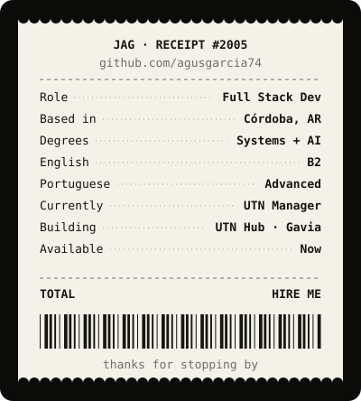

<picture>
  <source media="(prefers-color-scheme: dark)" srcset="assets/header-dark.svg" />
  <source media="(prefers-color-scheme: light)" srcset="assets/header-light.svg" />
  
</picture>

  
  

<table>
<tr>
<td width="58%" valign="top">

### Hi, I'm Juan 👋

I'm a **full stack developer** from Córdoba, Argentina, studying **Information Systems Engineering** and a **degree in Artificial Intelligence** at UTN.

I build software for problems I see up close: the virtual classroom nobody checks in time, the printer that refuses to talk to your phone, the meal order lost in a group chat. I like taking things **end to end**: understanding the problem, modeling the data, building the API and the interface, and leaving it running in production.

- 🛠️ **Building:** UTN Manager, and UTN Hub with friends
- 🧭 **Co-founder** of [Gavia](https://www.gaviasoftware.com), a custom software studio
- 🎓 **Studying:** Systems Engineering + AI @ UTN
- 🪐 **Off the keyboard:** astronomy (Jupiter is my favorite planet)
- 🐦 My friends call me *la garza*, the heron

</td>
<td width="42%" valign="top" align="center">
<picture>
  <source media="(prefers-color-scheme: dark)" srcset="assets/ticket-dark.svg" />
  <source media="(prefers-color-scheme: light)" srcset="assets/ticket-light.svg" />
  
</picture>
</td>
</tr>
</table>

---

### 🚀 What I'm working on

| Project | What it does | Built with |
|---|---|---|
| **[UTN Hub](https://www.utnhub.com.ar)** team · in development | Academic platform for UTN students: exam calendar, shared notes and a grade manager with automatic averages. Backend on an Oracle Cloud VM we set up from scratch. | React · Django REST · PostgreSQL · Oracle Cloud |
| **UTN Manager** solo · in development | Syncs Moodle and Autogestión, detects what changed and builds a changelog by topic, exams first. Telegram bot, Google Calendar and a daily sync. | Python · FastAPI · SQLAlchemy · React · TypeScript |
| **PrintServer** solo · in use | Turns an ordinary printer into a network printer: print from your phone with N-up layouts, manual duplex, previews and history. | Python · Flask · PyMuPDF · PowerShell |
| **[Gavia](https://www.gaviasoftware.com)** co-founder | Custom software studio for small businesses, in five stages with a fixed price per stage. | Astro · TypeScript · MapLibre |
| **[Orden 66 Viandas](https://vianda-app-front.vercel.app/)** team · shipped | Meal ordering with daily quotas, JWT auth, roles, order states and an admin panel. | React · Express · Node.js · SQLite |

---

### 🧰 Stack

  

  

  

---

### 🐦 The flock eats my contributions

<picture>
  <source media="(prefers-color-scheme: dark)" srcset="https://raw.githubusercontent.com/agusgarcia74/agusgarcia74/output/contributions-dark.svg" />
  <source media="(prefers-color-scheme: light)" srcset="https://raw.githubusercontent.com/agusgarcia74/agusgarcia74/output/contributions.svg" />
  
</picture>

---

  Designed and built in Córdoba · <a href="mailto:juanagustingarcia74@gmail.com">juanagustingarcia74@gmail.com</a>

